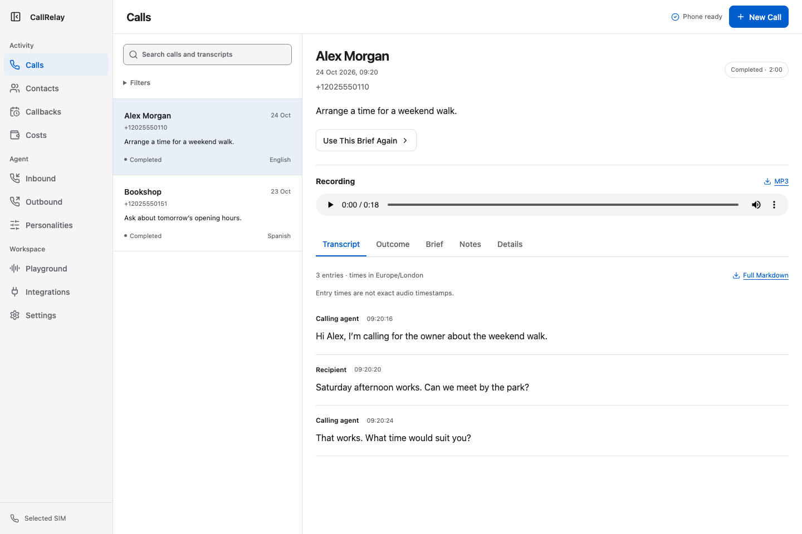
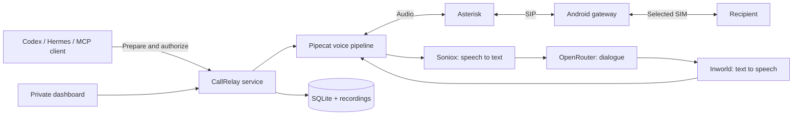

# CallRelay

**Let your AI assistant make phone calls through an Android phone.**

[](https://github.com/highsierraloft/callrelay/actions/workflows/ci.yml)
[](https://github.com/highsierraloft/callrelay/actions/workflows/secret-scan.yml)
[](LICENSE)
[](phone/LICENSE)

Give an assistant a task. Review the brief. Let the voice agent make the call. Get the recording and full transcript back.

CallRelay connects an MCP client, a streaming voice pipeline, Asterisk, and an Android SIM gateway.
The dashboard manages calls, contacts, personalities, prompts, and callbacks.
CallRelay stores its call history locally. Audio and text go to the voice providers you select.
Provider keys stay in server-side settings.

Built on [Agent Call](https://github.com/XiyaoWang0519/agent-call) and [Android Voice SIP Agent](https://github.com/sparkcyf/android-voice-sip-agent), with the platform extensions described below.

**Community preview:** the software has automated tests, but each new phone installation needs a controlled handset test.
Inbound reception starts disabled. No real calls run in the test suite.

<picture>
  <source media="(prefers-color-scheme: dark)" srcset="docs/images/workspace-dark.png">
  
</picture>

*The screenshots use fictional contacts and conversations.*

[Install](docs/self-hosting.md) · [Architecture](docs/architecture.md) · [MCP clients](docs/integrations.md) · [Contribute](CONTRIBUTING.md) · [Upstream credits](UPSTREAM.md)

## One brief, one call, a complete record

> Call the workshop, reach the service department, and ask when they open tomorrow. Do not book anything.

1. Your assistant collects missing details and prepares a call plan.
2. You authorize the call. The service starts that plan once.
3. The voice agent talks, listens, handles interruptions, and navigates phone menus.
4. The service returns an MP3 recording and a full Markdown transcript.

A lost start response does not cause a second call. The client can recover the original call by its plan ID.

## What you can do

| Area | Features |
| --- | --- |
| Calls | Outbound calls, live transcripts, recordings, notes, tags, search, and downloads |
| Agent | Shared instructions, reusable personalities, recipient context, dynamic tasks, and version history |
| Playground | Browser voice or text practice without a telephone call |
| Phone menus | Keypad digits, extensions, silent hold, and return to a human conversation |
| Contacts | Related call history, summaries, evidence-linked memory, and owner corrections |
| Reception | Separate inbound instructions, business facts, intake questions, and caller recognition |
| Callbacks | Confirmed schedules, one dialing attempt, cancellation, and missed-window tracking |
| Integrations | MCP tools for Codex, Hermes, and other clients with private network access |
| Costs | Provider usage and estimates, with clear missing-data states |

The voice agent supports English, Spanish, Russian, and Ukrainian.
Model and voice choices can change per personality.
Saved changes apply to future plans. Prepared and active calls keep their original settings.

## How it works



MCP is the interface an assistant uses to request and manage a call.
SIP carries call signaling and audio between Asterisk and the phone gateway.
The selected SIM connects to the normal telephone network.

The main path uses **Python, FastAPI, SQLite, React, TypeScript, Pipecat, Asterisk, and Kotlin**.
It uses your own OpenRouter, Soniox, and Inworld accounts. Twilio and a separate OpenAI account are not required for this path.

The original Twilio/OpenAI backend remains a separate option. See [backend choices](docs/architecture.md#backend-choices).

## Start here

### Explore without a phone

```bash
git clone https://github.com/highsierraloft/callrelay.git
cd callrelay
uv sync --extra android --all-groups --frozen
uv run callrelay doctor --dummy
```

The dummy check uses an isolated evaluation profile. It does not place a call or use provider credentials.

For a container-based API evaluation, run:

```bash
docker compose up --build
```

This evaluation listens on loopback and disables live calls. It does not provide a configured phone dashboard.

### Connect your own phone

You need a spare Android phone, an active SIM, a Linux server with USB access, and Tailscale.
The phone needs Wi-Fi access to the server and approved USB debugging access.
Hardware and Android audio support vary.

```bash
uv run python scripts/configure_phone.py
```

The setup tool asks for your installation details and provider keys. It creates a new `private/` directory with restricted permissions.
It does not contact a phone, change a firewall, or start services. Existing credentials are never overwritten.

Continue with the [installation guide](docs/self-hosting.md).
The guide covers the gateway build, SIM selection, USB access, private dashboard, MCP connection, and acceptance checks.

## Clear boundaries

- One installation has one owner and one active telephone call.
- The phone uses an explicitly selected SIM. It never falls back to another line.
- Browser practice cannot dial or update real contacts, memory, opt-outs, or schedules.
- The supervisor recovers phone control. It never places or answers a call itself.
- Caller ID helps recognition. It does not authenticate a person.
- A completed call is not proof that the task succeeded.
- Provider credentials never enter browser JavaScript.

CallRelay is a calling system, not an emergency service or a bulk-dialing platform.
The operator controls contact permission, recording policy, provider accounts, and carrier charges.

## Source and operator data stay separate

| In this repository | In your ignored `private/` directory |
| --- | --- |
| Application and gateway source | Provider and SIP credentials |
| Tests with fictional data | Device identifiers and ADB identity |
| Portable deployment templates | Phone numbers and installation settings |
| Synthetic fallback prompts | SQLite records, MP3 files, and transcripts |
| Documentation and upstream notices | Backups and local logs |

This repository contains no production database, signing key, deployment credential, or prior deployment history.
The Android app uses its own application ID and signing-property prefix.

## Project map

| Path | Purpose |
| --- | --- |
| `app/` | Calling service, MCP tools, storage, and voice pipeline |
| `dashboard/` | React control panel and browser tests |
| `phone/` | Android gateway, with its own GPL license |
| `supervisor/` | USB and Shizuku recovery controller |
| `deploy/` | Asterisk, proxy, and standalone Compose settings |
| `integrations/` | Optional client skills and integration examples |
| `docs/` | Installation, architecture, operation, and contributor guides |

## Built on open source

CallRelay extends [Agent Call by XiyaoWang0519](https://github.com/XiyaoWang0519/agent-call)
and [Android Voice SIP Agent by sparkcyf](https://github.com/sparkcyf/android-voice-sip-agent).
It keeps their notices and identifies the added platform features in [UPSTREAM.md](UPSTREAM.md).

The Python platform and dashboard use the [MIT license](LICENSE).
The separate Android gateway uses [GPL-2.0-or-later](phone/LICENSE), with the upstream Apache-2.0 linking exception.
The platform license does not replace the gateway license. See [component licenses](LICENSES.md).

## Contribute

Start with [CONTRIBUTING.md](CONTRIBUTING.md) and the [development guide](docs/development.md).
Report vulnerabilities through the [security process](SECURITY.md).
