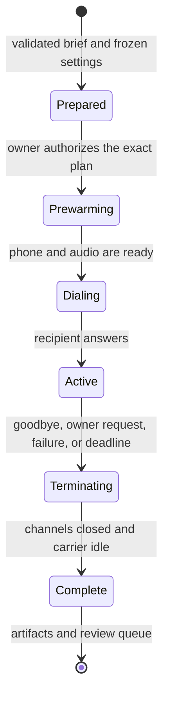

# Architecture

CallRelay separates the call request, the conversation, the telephone connection, and stored records.

## Components

| Component | Role | Access |
| --- | --- | --- |
| React dashboard | Edit settings and inspect calls | Authenticated administration API |
| FastAPI service | Prepare, start, stop, and record calls | SQLite, provider keys, and Asterisk API |
| Pipecat pipeline | Speech recognition, dialogue, and speech output | Selected voice providers and owned audio channel |
| Asterisk | SIP signaling, media bridge, and recording | The configured gateway and worker |
| Android gateway | Bridge the selected cellular line to SIP | Pinned phone account and Shizuku audio control |
| USB supervisor | Restore control after a disconnect or reboot | One configured handset; no network |
| MCP client | Supply the brief and interpret results | Authenticated MCP tools |

The worker has no ADB access. The dashboard has no direct access to an assistant's home directory.

## Call lifecycle

Preparation does not dial. A start claim binds one plan to one call.
After an uncertain start response, the client looks up the original plan. It does not create a replacement call automatically.

Incoming calls use a separate admission path. They retain their real Asterisk channel ID.
They never enter the outbound dialing path.
Before answer, a rejected admission releases the incoming call to native handset handling.

## Conversation inputs

The effective prompt combines shared instructions, personality, recipient context, the current task, and service rules.
A personality changes speaking style. It does not grant permission to spend money or make new commitments.
Recipient speech and stored memory are data, not new system instructions.

Each plan stores its resolved prompt, profile revision, voice settings, and confirmation summary.
The AI input inspector uses the same builders as execution.
Old calls without a snapshot show that the information was not recorded.

## Audio and phone menus

Soniox supplies streaming speech recognition. OpenRouter supplies the dialogue model. Inworld supplies speech output.
Pipecat controls interruptions and paced playback. Provider choices remain explicit settings.

The voice agent sends keypad digits through Asterisk to the owned phone channel.
The Android gateway forwards them to the cellular keypad.
Duplicate requests return their original receipt. An unknown dispatch result does not trigger a blind retry.

Menu tool commentary stays out of speech. Explicit hold announcements keep the agent quiet.
Ordinary replies keep streaming. A recipient reply cancels a pending goodbye.

## Records and memory

SQLite stores plans, call state, transcript turns, revisions, contacts, review jobs, and callbacks.
Recordings and exported files live beside the database, outside the source tree.
Owner notes remain separate from reusable conversation memory.

A review agent claims a completed call, reads its transcript, and commits the summary and eligible memory together.
Expired claims can recover. Calls use the last committed memory while a review is pending.
The live voice pipeline does not require another summary model.

## Callback scheduling

The voice agent reads back the destination, purpose, date, timezone, and window.
A clear confirmation permits the service to save a schedule receipt.
Only that receipt permits the agent to say that the callback is scheduled.

The dispatcher creates a fresh plan near the due time. It rechecks policy, suppression, readiness, and capacity.
Each confirmed request gets one automatic dialing attempt.
A restart or lost response does not authorize a replacement call.

## Backend choices

The community installation uses `android_openrouter`. This path uses a physical Android SIM and the Pipecat pipeline.

The inherited `twilio_openai` backend remains for compatibility and development evaluation.
Its live mode needs separate Twilio and OpenAI settings.
It does not use the Android gateway or the private dashboard deployment recipe.

## Scope

This release targets one owner and one phone line. It does not provide a public multi-tenant service.
The standalone deployment is separate from any existing operator installation.
No cloud resource identifiers or operator deployment scripts are part of its setup path.
